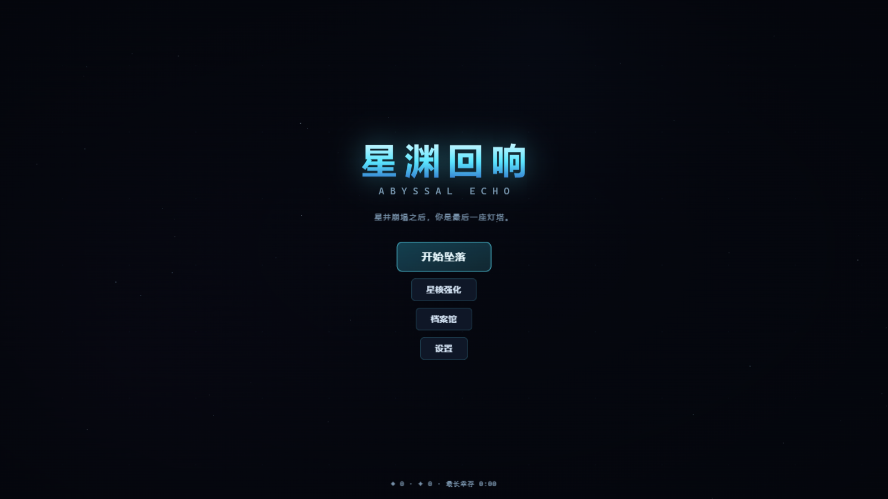
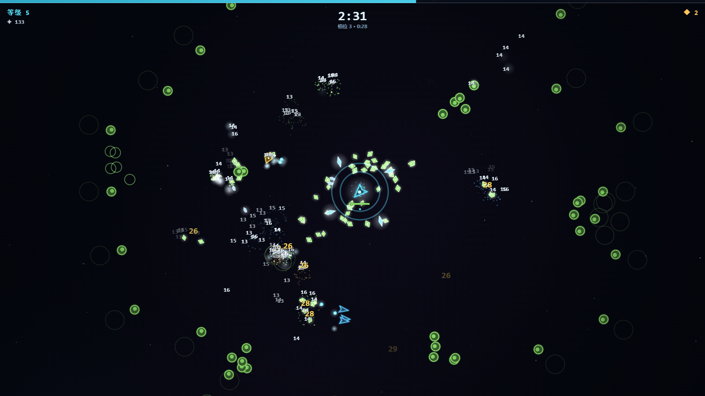
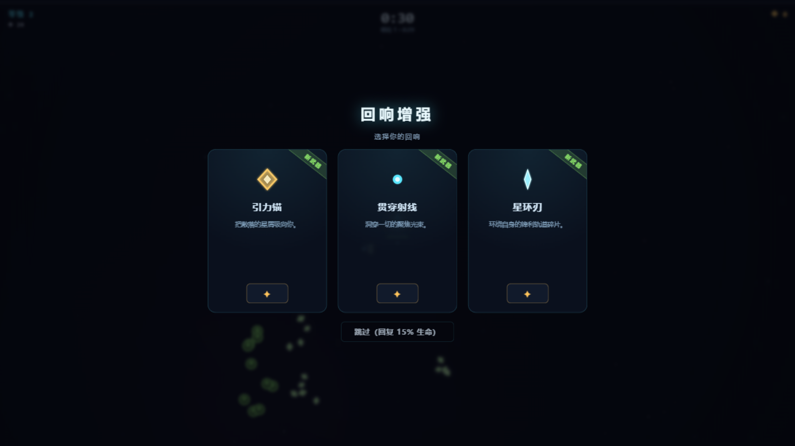
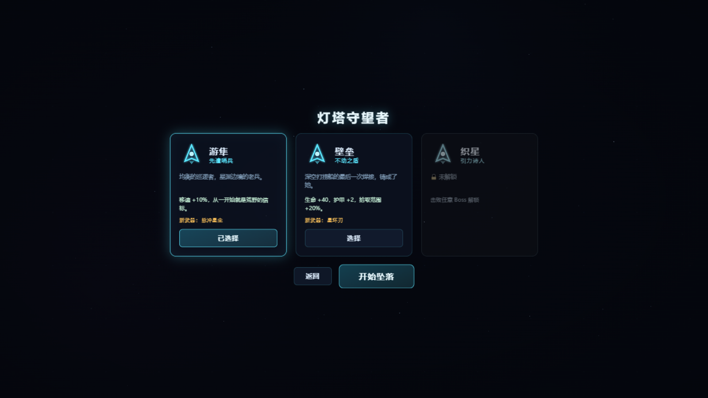
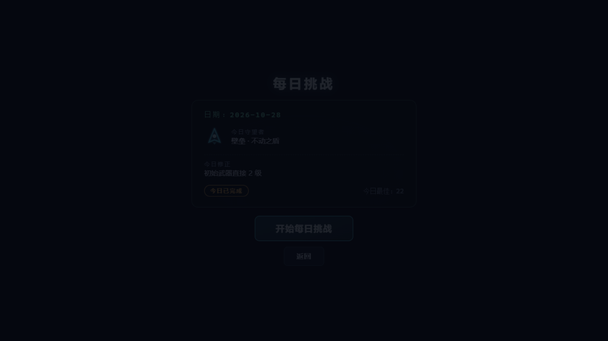
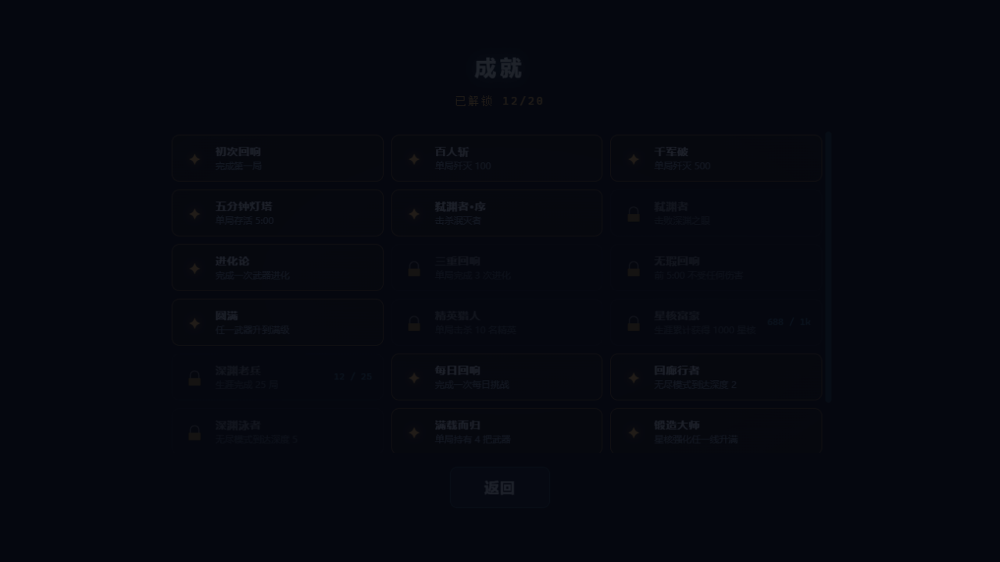
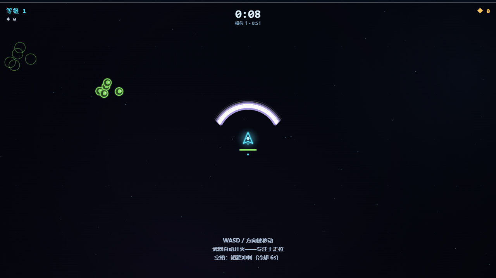

<div align="center">

# 星渊回响 · ABYSSAL ECHO

**The starwell has collapsed. You are the last lighthouse.**

*星井崩塌之后，你是最后一座灯塔。*

[](LICENSE)
[](tsconfig.json)
[](#%EF%B8%8F-development)
[](#-why-zero-assets--为什么是零资源)
[](#-android)

A **survivors-like roguelite**: weapons fire on their own — you only walk.
Survive a collapsing star-well for 9 minutes, build your arsenal of echoes, and end what rises at the final minute.

一款 **survivors-like 弹幕生存 roguelite**：武器全自动开火，你只负责走位。在崩塌的星井中存活 9 分钟，构筑你的回响武库，并在最后一分钟终结深渊之物。

**[▶ PLAY NOW · 双击即玩](#-play--开始游戏)** · [Android APK](#-android) · [设计文档](docs/DESIGN.md)

</div>

---

| Title / 标题 | Endgame / 终盘 | Level up / 升级三选一 | Keepers / 守望者 |
|:---:|:---:|:---:|:---:|
|  |  |  |  |

**v1.1 新增** · 无尽回廊（深度结算）· 每日挑战（全局种子+修正器）· 成就系统（20 项）
| Daily / 每日挑战 | Achievements / 成就 | Void Scythe / 虚空收割 |
|:---:|:---:|:---:|
|  |  |  |

## ✦ Why "zero assets" / 为什么是"零资源"

Every pixel is drawn with code at boot (procedural sprite atlas), every sound is synthesized with WebAudio (adaptive music included). There is **no binary asset in this repository** — clone it and you have the complete game.

所有像素在启动时用代码绘制（程序化精灵图集），所有声音用 WebAudio 实时合成（含随战况起伏的自适应音乐）。仓库里**没有任何二进制资源文件**——克隆下来就是完整的游戏。

## ✦ Features / 特性

- **3 game modes / 3 种模式** — Standard 9-minute run · **Endless Corridor** (loops with scaling depth) · **Daily Challenge** (seeded, global, 1 modifier) / 标准 9 分钟局 · **无尽回廊**（循环加深）· **每日挑战**（全日期同种子 + 修正器）
- **20 achievements / 20 项成就** — live toasts + progress tracking / 实时 toast + 可量化进度
- **4 keepers / 4 位守望者** — unique starting weapons & stats, 3 unlockable / 各有专属初始武器与面板，3 位需解锁
- **10 weapons → 10 evolutions / 10 武器 + 10 进化** — max a weapon and pair it with its passive at Lv3 to evolve / 武器满 5 级 + 绑定被动满 3 级触发进化
- **10 passives / 10 条被动** — damage, tempo, crit, armor, magnet, greed… / 伤害、冷却、暴击、护甲、磁吸、贪婪……
- **14 enemies / 14 种敌人** — 8 normals + 4 elites + 2 boss state machines / 8 普通 + 4 精英 + 2 个 Boss 状态机
- **9-minute pressure curve / 9 分钟压力曲线** — 9 wave phases, timeline events, elites & swarms / 9 个相位 + 时间轴事件
- **Roguelite meta / 永久成长** — earn Starcores ◆ every run, spend them in the Forge / 每局结算星核 ◆，星核强化 6 条线
- **Codex & records / 档案馆** — bestiary & lifetime stats / 威胁图鉴与生涯统计
- **zh / EN** — switch anytime in Settings / 设置内随时切换
- **Mobile / 移动端** — auto virtual joystick + dash button in landscape / 横屏自动虚拟摇杆 + 冲刺键

## ▶ Play / 开始游戏

**Web（推荐）**

```bash
npm install
npm run build        # 产出 dist/index.html —— 单文件，双击即玩，完全离线
```

或者直接体验开发版：

```bash
npm run dev          # http://localhost:5199
```

**操作 / Controls**：`WASD / 方向键` 移动 · `空格` 冲刺 · `Esc` 暂停 · 武器全自动

## 📱 Android

横屏沉浸式全屏，触屏自动虚拟摇杆，**无需任何权限**（纯单机）。

| 渠道 | 说明 |
|---|---|
| GitHub Releases | 下载签名 APK 直接安装（最快） |
| 自己构建 | 见下方命令 |

```bash
npm install && npm run build && npx cap sync android
cd android && ./gradlew assembleDebug    # 产物: app/build/outputs/apk/debug/
```

签名发布版（keystore 不入库，自行生成）：

```bash
keytool -genkeypair -keystore abyssal.keystore -alias abyssal \
  -keyalg RSA -keysize 2048 -validity 10000
# 在 android/ 下创建 keystore.properties，然后：
cd android && ./gradlew assembleRelease
```

## ⚙️ Development / 开发

```bash
npm test             # Vitest — 74 个单元测试（RNG / 平衡曲线 / 升级规则 / 模拟决定性 / 存档防御 / 模式 / 成就 / 新武器）
npm run lint         # ESLint (typescript-eslint) — 0 warning
npm run build        # tsc --noEmit + vite build（单文件产物）
```

**Architecture in one line / 架构一句话**：60Hz deterministic sim (`src/game/`) never touches rendering (`src/render/`) or audio (`src/audio/`) — the presentation layer only observes `RunState.events`. Same seed → same run.

深入阅读：[`docs/ARCHITECTURE.md`](docs/ARCHITECTURE.md)（架构） · [`docs/DESIGN.md`](docs/DESIGN.md)（数值设计与调参表） · [`CHANGELOG.md`](CHANGELOG.md)

## ✦ 中文速览

**玩法**：星井崩塌，深渊之物自渊底上浮。你操作最后一位守望者，在敌群中存活——所有武器自动开火，你只需专注于走位、拾取经验星屑、在升级三选一中构筑流派。武器满级后与对应被动共鸣触发**进化**。每局结束按表现获得**星核 ◆**，用于永久强化，让下一次坠落走得更深。

**目标**：9:00 时深渊之眼上浮——击败它，星渊归于寂静。意犹未尽？击败过一次后开启**无尽回廊**：回响不止，看你能走多深。每天还有一局**每日挑战**——全日期玩家同一份种子、同一个修正器，比比谁分高。

**成就**：从「初次回响」到「三面守望」共 20 项，实时 toast 提醒，生涯进度可量化。

**难度**：第一次死亡通常发生在 2~4 分钟，这是正常的。星核会累积，每一局都比上一局更强。觉得难/简单想调数值？所有平衡参数集中在 [`src/data/`](src/data/)，调参表见设计文档。

## License / 许可

[MIT](LICENSE) — free to play, modify, and ship. If you make something cool with it, a star would be lovely. / 随意游玩、修改、发布。用它做了有趣的东西，赏颗星就好。
